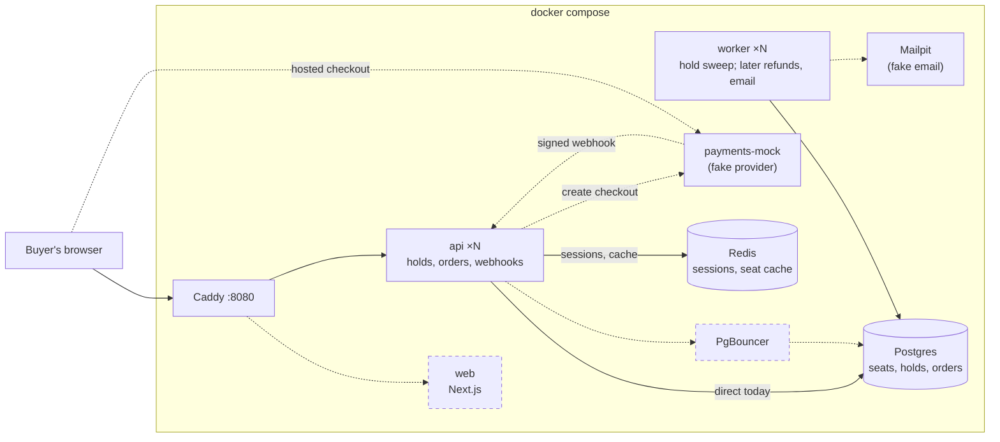

# Ticket booking under heavy load

Thousands of buyers compete for a fixed number of seats, and no seat is ever sold twice.

The step-by-step build plan is in [PLAN.md](PLAN.md).

> **Status:** Phase 2. Accounts, a 5,000-seat map and 10-minute holds work, with seats or general admission, and no seat can be held twice. Payments and the waiting room aren't built yet.

## Run it

```bash
git clone --recurse-submodules https://github.com/gonzalo-gigena/ticket-booking.git
cd ticket-booking
cp .env.example .env
docker compose up --watch
```

Open http://localhost:8080. Needs only Docker with Compose v2. Code changes reload
automatically (Compose Watch). On Windows, clone inside the WSL filesystem, not `/mnt/c`.

Cloned without `--recurse-submodules`? Run `git submodule update --init`.

The seat map is empty until you seed it: `docker compose run --rm seed`.

## Everyday commands

| What | Command |
|---|---|
| Seed demo data | `docker compose run --rm seed` |
| SQL shell | `docker compose exec db psql -U app app` |
| Make a user an admin (then log in again) | `docker compose exec db psql -U app app -c "UPDATE users SET role='admin' WHERE email='you@example.com'"` |
| Scale the api | `docker compose up -d --scale api=3` |
| Prove scaling works | `sh common/scripts/smoke.sh 3` |
| Run exactly what CI runs | `sh common/scripts/ci-stack.sh 3` |
| Load test at 1, 2, 4 replicas | `sh common/scripts/scale.sh` |
| Metrics (Prometheus) | `docker compose --profile observability up -d`, then http://localhost:9090 |
| Unit tests | `docker run --rm -v "$PWD/apps/api:/app" -w /app node:26.13-bookworm-slim node --test` |
| Integration tests (auth, seat map, holds and the 1,000-client `hold_race`, through Caddy, asserted with SQL) | `docker compose --profile tools run --rm api-test` |
| Lint migrations for the lock rules | `sh common/scripts/check-migrations.sh` |
| Apply pending migrations under load, rolling the api | `sh common/scripts/migrate-under-load.sh` |
| New migration | add `infra/db/migrations/00000N_name.up.sql` + `.down.sql`, restart |
| Update shared code | `git submodule update --remote common` |
| Reset everything | `docker compose down -v` |

## Fakes (from common)

These start in dev and CI (`COMPOSE_PROFILES=fakes`), never in production.
Full reference: [`common/README.md`](common/README.md).

| Service | What |
|---|---|
| `payments-mock` | Fake payment provider. Checkout pages at http://localhost:8090. The api calls `http://payments-mock:8090`, and webhooks go to `PAYMENTS_WEBHOOK_URL`. |
| `mailpit` | Catches all email. Send to `smtp://mailpit:1025`, read at http://localhost:8025. |

## API

| Route | What |
|---|---|
| `POST /api/register`, `POST /api/login` | JSON `{email, password}`. Sets the `sid` cookie. |
| `POST /api/logout` | Deletes the session. |
| `GET /api/me` | The session's user ID and role, or 401. |
| `GET /api/events` | Public, cached for 1.5 s. |
| `GET /api/seats?event=1` | Public, cached for 1.5 s. Each seat is `[id, section, row, number, price_cents, status]`, status 0 available, 1 held, 2 sold. |
| `POST /api/holds` | Logged in. `{event_id, seat_ids}` (1–8 seats) or, for general admission, `{event_id, quantity}` (1–8). 201 with the hold ID and `expires_at` (10 min). 409 with `taken` seat IDs, when tickets run out, or when the user already has an active hold for the event. |

## Architecture



Solid boxes and arrows run today. Dashed ones are planned in [PLAN.md](PLAN.md).

Postgres row locks decide who gets each seat. Everything in front of Postgres (the waiting room, the seat-map cache, rate limits) exists to keep the load on those locks bounded.

## Stack

- **api:** Node 26 (`node:http`, `pg`, `redis`), plain JavaScript. Stateless, so it scales with `--scale api=N`.
- **Caddy:** the only service with a host port. It load-balances `/api/*` across every
  replica (`import lb api 8080`, from common) and serves `apps/web`.
- **Postgres 18:** migrations run once before the api starts (`golang-migrate`).
- **Redis 8:** sessions and the seat-map cache. No volume yet, so recreating it logs everyone out.
- **apps/web:** one static HTML file with an SVG seat map.
- **common/:** git submodule with the shared fakes, scripts, Caddy snippet and Prometheus.
  See [portfolio-common](common/README.md).

## Deploy (one VM)

```bash
docker compose -f compose.yaml -f compose.prod.yaml up -d
```

The server's `.env` needs `SITE_ADDRESS`, `IMAGE_REPO`, `TAG`, a strong password, and no `fakes`
profile. Caddy gets TLS automatically. CI pushes multi-arch images to GHCR on every merge to `main`.

## Decisions & tradeoffs

| Decision | Chosen | Rejected | Why, and what it costs |
|---|---|---|---|
| Preventing double booking | `SELECT … FOR UPDATE` on the seat rows, in seat order, in one transaction | Redis locks, or optimistic version checks with retries | The database that records the sale also enforces it, so there's no gap between two systems. Locking in a fixed order means overlapping holds can't deadlock. Cost: hot sections contend on the same rows. |
| Last line of defense | Partial unique index on `order_items (event_id, seat_id) WHERE status = 'paid'` | Trusting the app code | Even a bug can't sell a seat twice, and a refunded seat can still be sold again. |
| Hold expiry | Lazy: the hold query treats an expired hold as free. The `worker` sweeps every 30 s. | A timer per hold, or Redis key expiry | There's no timer to lose on a restart, and seats never depend on the sweeper running. General admission does: its counter only gets expired tickets back when the sweep runs, or when the same user holds again. The seat map already shows expired holds as free, so the sweep pushes nothing until Phase 5. |
| One active hold per user per event | `UNIQUE (user_id, event_id)` on `holds`, `INSERT … ON CONFLICT DO NOTHING`, after deleting that user's expired hold in the same transaction | Checking in app code first | Two simultaneous requests from one user can't both win: the second waits on the unique key and gets nothing. With the 8-per-hold cap, that also caps each user at 8 per event. |
| General admission | `UPDATE inventory SET remaining = remaining - $n WHERE … AND remaining >= $n`, plus `CHECK (remaining >= 0)` | A row per ticket | One statement, no lock ordering to get right. Cost: the single row is the hot spot for that event. |
| Caddy → api keep-alive | api `keepAliveTimeout` 130 s, longer than Caddy's 2 min | Node's 5 s default | At 5 s, Caddy reused sockets Node had just closed. Its passive health check then marked every replica down for 10 s, and `hold_race` got 503s. |
| Payments | Hosted checkout and a signed webhook. Idempotency key = hold ID. Webhooks stored with `UNIQUE (provider, event_id)` and processed by the worker | Taking card details in our own form, or processing webhooks inline | Card data never touches the app. Double clicks and webhook replays are no-ops. Answering 200 fast stops provider retries from piling up. |
| Payment after the hold expired | Take the seats if they're still free, otherwise refund automatically and email the buyer | Rejecting the webhook | The money already moved, and rejecting the webhook doesn't give it back. Pending orders are also polled, because webhooks get lost. |
| Traffic spikes | A waiting room: a Redis sorted set, and an admitter that lets N users/s through with single-use tokens | Autoscaling into the spike | The bottleneck is seat-row locks, not api CPU, so more replicas would just queue on Postgres. Cost: Redis needs AOF on, so a restart mid-sale doesn't empty the queue. |
| Passwords | argon2id from `node:crypto` (19 MiB, 2 passes), stored as PHC strings | The `argon2` npm package, bcrypt | No native dependency to build for two architectures, and the format is portable. Cost: each login takes 19 MiB and tens of milliseconds of CPU. |
| Sessions | Random token in an HttpOnly, SameSite=Lax cookie. Redis stores its SHA-256 | JWTs | Logout revokes at once, and a leaked Redis dump holds no usable cookies. Cost: a role change applies at the next login, and Redis must be up. |
| Seat-map cache | Whole response as one JSON string in Redis for 1.5 s, one refill query at a time per replica | A key per seat, or invalidating on write | A hit never parses 5,000 seats, and N replicas send at most about N queries per 1.5 s per event. Cost: the map can be 1.5 s stale until Phase 5. With Redis down, browsing fails instead of falling through to Postgres. |
| Payment provider in dev and CI | `payments-mock` from `common/`: checkout page, HMAC-signed webhooks, retries, out-of-order delivery | Stripe or Mercado Pago test mode by default | Runs with no account and no public URL for webhooks. A real provider in test mode is selected by env var. |
| Load balancing | Caddy `dynamic a` upstreams (the `lb` snippet in `common/`) | `reverse_proxy api:8080`, Traefik | Caddy re-reads Docker DNS every 5 s, so `--scale api=N` needs no config change and no Docker socket mount. A plain `reverse_proxy api:8080` is a single upstream to Caddy and doesn't reliably spread load. |
| Migrations | A one-shot `migrate` service that finishes before the api starts | Each replica migrating on boot | Replicas starting together would race on the same migration. |

Rows for parts that aren't built yet record the plan's choice. Each one gets confirmed or revised when that phase is built.

## Scaling

### Measured: seat map with 5,000 seats (target: under 200 ms)

**On a quiet laptop, p95 is 46–54 ms from the cache and 71–79 ms on a cache miss, and a fresh browser's first load takes 42–124 ms.** That is navigation start to painted seats in headless Chrome 158 on an Apple M1, HTTP cache off, through Caddy to 1 api replica, with no network latency. Each row is 30 loads.

```bash
node infra/loadtest/pageload.mjs http://localhost:8080 30
```

The same three runs on four occasions, with different amounts of other Docker work on the machine:

| Host (8 CPUs) | Cache hit p95 | Cache miss p95 | First load, fresh browser | Under 200 ms |
|---|---|---|---|---|
| Quiet: load avg 3–5, no other projects | 46–54 ms | 71–79 ms | 42–124 ms | 180/180 |
| Moderate: load avg 7–9, 8 other containers | 59–75 ms | 70–111 ms | 89–286 ms | 179/180 |
| Busy: load avg 6.5–11.4, one container at 400% CPU | 76–91 ms | 118–395 ms | 161–277 ms | 176/180 |
| Oversubscribed: load avg 16–31 | 161–276 ms | 477–526 ms | 204–1,059 ms | not met |

The target is missed only when other work competes for the CPU. With Chrome's CPU slowed 4× (`CPU_SLOWDOWN=4`, 20 loads per row, two runs at load avg 5–8), misses stayed at p95 168–169 ms. Hits were at p95 132 ms in one run and 383 ms in the other (18/20 under 200).

Where a fresh browser's first load spends its time (5 loads at load avg 9–10, 85–119 ms in total): the HTML arrives at 10–24 ms, and the seats request, a cache miss, takes 42–76 ms. On a miss, the api spends about 26 ms:

| Step on a cache miss | Median |
|---|---|
| `pg` turns 5,000 rows into JS objects (Postgres runs the query in 1.5 ms) | 18 ms |
| Caddy gzips 117 KB down to 25 KB | 5 ms |
| Packing, `JSON.stringify` and the Redis write | 3 ms |

Building the JSON in Postgres with `json_agg` would save about 5 ms of that. It was rejected: the hold-expiry rule would move out of unit-tested JS into SQL for a few percent of a first load.

`GET /api/seats?event=1` alone (117 KB, 25 KB gzipped):

| Test | p50 | p95 |
|---|---|---|
| curl, cache miss (50 requests, 1.7 s apart) | 38 ms | 98 ms |
| curl, mostly cache hits (100 in a row) | 18 ms | 56 ms |
| k6, 20 virtual users for 20 s: 739 req/s, 0 failed | 21 ms | 62 ms |

600 seat-map requests in about 4 s caused 6 scans of `seats` in Postgres, with 3 replicas. The page shows its own load time next to the legend. To repeat the k6 row:

```bash
COMPOSE_FILE=compose.yaml docker compose --profile loadtest run --rm -e "URL_PATH=/api/seats?event=1" k6 run /scripts/main.js
```

### Measured: the skeleton

The Phase 0 baseline: k6 with 20 virtual users for 20 s against `GET /api/hello`, which reads one row from Postgres through Caddy. Run on an Apple M1 laptop with 8 CPUs and 8 GB given to Docker, with the dev override left out:

```bash
COMPOSE_FILE=compose.yaml sh common/scripts/scale.sh
```

| api replicas | req/s | p95 latency | failed |
|---|---|---|---|
| 1 | 14,729 | 2.48 ms | 0.00% |
| 2 | 12,291 | 3.15 ms | 0.00% |
| 4 | 11,330 | 3.63 ms | 0.00% |

4 replicas served 0.8× the requests of 1. At 1 replica the api used about one core, while Caddy, Postgres and k6 together used about four of the laptop's eight (sampled with `docker stats` during the run). The api isn't the bottleneck on one machine, so more replicas only compete for the same CPUs. Replicas pay off when the api is the busiest process, and a hello endpoint doing one query isn't.

### How each part scales

| Part | Scales by | Limit |
|---|---|---|
| `api` | `--scale api=N` (stateless) | Holds are short transactions. Connections need PgBouncer past ~2 replicas. |
| `worker` | `--scale worker=N` | Webhook processing rate |
| Postgres | One primary | Row-lock contention on popular sections |
| Redis | One instance, AOF on | Waiting room, cache and pub/sub share it |
| Waiting room | Admission rate, users/s | Set it to what Postgres can confirm, not what the api can serve |

### Where it breaks next

- **Row-lock contention on hot sections during an on-sale.** Next: shard inventory per section, or reserve seats in Redis with a Lua script and confirm in Postgres.
- **Postgres connections past ~2 api replicas.** PgBouncer in transaction mode.

Phase 7 adds the real tests (`browse`, `spike_onsale`, `hold_race`) at 1, 2 and 4 replicas, recording req/s, p95, errors and duplicate sales, which must stay at 0.
