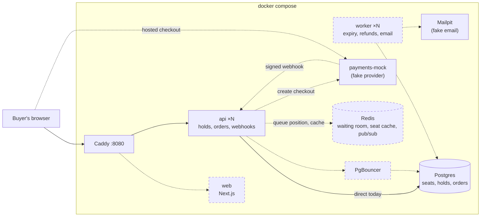

# Ticket booking under heavy load

Thousands of buyers compete for a fixed number of seats, and no seat is ever sold twice.

The step-by-step build plan is in [PLAN.md](PLAN.md).

> **Status:** skeleton. The stack runs, scales and passes CI. The product itself isn't built yet.

## Run it

```bash
git clone --recurse-submodules https://github.com/gonzalo-gigena/ticket-booking.git
cd ticket-booking
cp .env.example .env
docker compose up --watch
```

Open http://localhost:8080. Needs only Docker with Compose v2. Code changes reload
automatically (Compose Watch). On Windows, clone inside the WSL filesystem, not `/mnt/c`.

Cloned without `--recurse-submodules`? Run `git submodule update --init`.

## Everyday commands

| What | Command |
|---|---|
| Seed demo data | `docker compose run --rm seed` |
| SQL shell | `docker compose exec db psql -U app app` |
| Scale the api | `docker compose up -d --scale api=3` |
| Prove scaling works | `sh common/scripts/smoke.sh 3` |
| Run exactly what CI runs | `sh common/scripts/ci-stack.sh 3` |
| Load test at 1, 2, 4 replicas | `sh common/scripts/scale.sh` |
| Metrics (Prometheus) | `docker compose --profile observability up -d`, then http://localhost:9090 |
| Unit tests | `docker run --rm -v "$PWD/apps/api:/app" -w /app node:26.13-bookworm-slim node --test` |
| New migration | add `infra/db/migrations/00000N_name.up.sql` + `.down.sql`, restart |
| Update shared code | `git submodule update --remote common` |
| Reset everything | `docker compose down -v` |

## Fakes (from common)

These start in dev and CI (`COMPOSE_PROFILES=fakes`), never in production.
Full reference: [`common/README.md`](common/README.md).

| Service | What |
|---|---|
| `payments-mock` | Fake payment provider. Checkout pages at http://localhost:8090. The api calls `http://payments-mock:8090`, and webhooks go to `PAYMENTS_WEBHOOK_URL`. |
| `mailpit` | Catches all email. Send to `smtp://mailpit:1025`, read at http://localhost:8025. |

## Architecture



Solid boxes and arrows run today. Dashed ones are planned in [PLAN.md](PLAN.md).

Postgres row locks decide who gets each seat. Everything in front of Postgres (the waiting room, the seat-map cache, rate limits) exists to keep the load on those locks bounded.

## Stack

- **api:** Node 26 (`node:http` + `pg`), plain JavaScript. Stateless, so it scales with `--scale api=N`.
- **Caddy:** the only service with a host port. It load-balances `/api/*` across every
  replica (`import lb api 8080`, from common) and serves `apps/web`.
- **Postgres 18:** migrations run once before the api starts (`golang-migrate`).
- **common/:** git submodule with the shared fakes, scripts, Caddy snippet and Prometheus.
  See [portfolio-common](common/README.md).

## Deploy (one VM)

```bash
docker compose -f compose.yaml -f compose.prod.yaml up -d
```

The server's `.env` needs `SITE_ADDRESS`, `IMAGE_REPO`, `TAG`, a strong password, and no `fakes`
profile. Caddy gets TLS automatically. CI pushes multi-arch images to GHCR on every merge to `main`.

## Decisions & tradeoffs

| Decision | Chosen | Rejected | Why, and what it costs |
|---|---|---|---|
| Preventing double booking | `SELECT … FOR UPDATE` on the seat rows, in seat order, in one transaction | Redis locks, or optimistic version checks with retries | The database that records the sale also enforces it, so there's no gap between two systems. Locking in a fixed order means overlapping holds can't deadlock. Cost: hot sections contend on the same rows. |
| Last line of defense | Partial unique index on `order_items (event_id, seat_id) WHERE status = 'paid'` | Trusting the app code | Even a bug can't sell a seat twice, and a refunded seat can still be sold again. |
| Hold expiry | Lazy: the hold query treats an expired hold as free. A sweeper tidies up every 30 s. | A timer per hold, or Redis key expiry | There's no timer to lose on a restart, and correctness never depends on the sweeper running. |
| Payments | Hosted checkout and a signed webhook. Idempotency key = hold ID. Webhooks stored with `UNIQUE (provider, event_id)` and processed by the worker | Taking card details in our own form, or processing webhooks inline | Card data never touches the app. Double clicks and webhook replays are no-ops. Answering 200 fast stops provider retries from piling up. |
| Payment after the hold expired | Take the seats if they're still free, otherwise refund automatically and email the buyer | Rejecting the webhook | The money already moved, and rejecting the webhook doesn't give it back. Pending orders are also polled, because webhooks get lost. |
| Traffic spikes | A waiting room: a Redis sorted set, and an admitter that lets N users/s through with single-use tokens | Autoscaling into the spike | The bottleneck is seat-row locks, not api CPU, so more replicas would just queue on Postgres. Cost: Redis needs AOF on, so a restart mid-sale doesn't empty the queue. |
| Payment provider in dev and CI | `payments-mock` from `common/`: checkout page, HMAC-signed webhooks, retries, out-of-order delivery | Stripe or Mercado Pago test mode by default | Runs with no account and no public URL for webhooks. A real provider in test mode is selected by env var. |
| Load balancing | Caddy `dynamic a` upstreams (the `lb` snippet in `common/`) | `reverse_proxy api:8080`, Traefik | Caddy re-reads Docker DNS every 5 s, so `--scale api=N` needs no config change and no Docker socket mount. A plain `reverse_proxy api:8080` is a single upstream to Caddy and doesn't reliably spread load. |
| Migrations | A one-shot `migrate` service that finishes before the api starts | Each replica migrating on boot | Replicas starting together would race on the same migration. |

Rows for parts that aren't built yet record the plan's choice. Each one gets confirmed or revised when that phase is built.

## Scaling

### Measured

The skeleton only, not the product yet: k6 with 20 virtual users for 20 s against `GET /api/hello`, which reads one row from Postgres through Caddy. Run on an Apple M1 laptop with 8 CPUs and 8 GB given to Docker, with the dev override left out:

```bash
COMPOSE_FILE=compose.yaml sh common/scripts/scale.sh
```

| api replicas | req/s | p95 latency | failed |
|---|---|---|---|
| 1 | 14,729 | 2.48 ms | 0.00% |
| 2 | 12,291 | 3.15 ms | 0.00% |
| 4 | 11,330 | 3.63 ms | 0.00% |

4 replicas served 0.8× the requests of 1. At 1 replica the api used about one core, while Caddy, Postgres and k6 together used about four of the laptop's eight (sampled with `docker stats` during the run). The api isn't the bottleneck on one machine, so more replicas only compete for the same CPUs. Replicas pay off when the api is the busiest process, and a hello endpoint doing one query isn't.

### How each part scales

| Part | Scales by | Limit |
|---|---|---|
| `api` | `--scale api=N` (stateless) | Holds are short transactions. Connections need PgBouncer past ~2 replicas. |
| `worker` | `--scale worker=N` | Webhook processing rate |
| Postgres | One primary | Row-lock contention on popular sections |
| Redis | One instance, AOF on | Waiting room, cache and pub/sub share it |
| Waiting room | Admission rate, users/s | Set it to what Postgres can confirm, not what the api can serve |

### Where it breaks next

- **Row-lock contention on hot sections during an on-sale.** Next: shard inventory per section, or reserve seats in Redis with a Lua script and confirm in Postgres.
- **Postgres connections past ~2 api replicas.** PgBouncer in transaction mode.

Phase 7 adds the real tests (`browse`, `spike_onsale`, `hold_race`) at 1, 2 and 4 replicas, recording req/s, p95, errors and duplicate sales, which must stay at 0.
